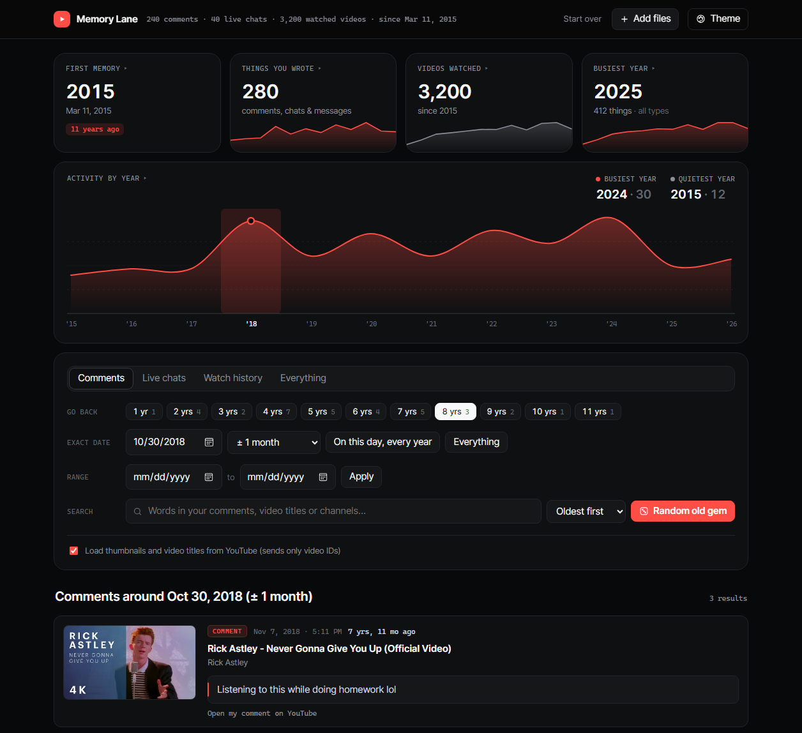
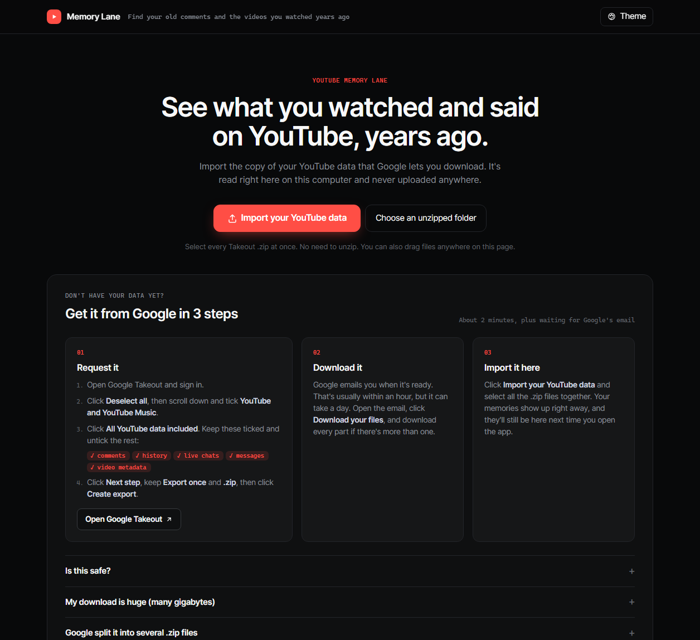
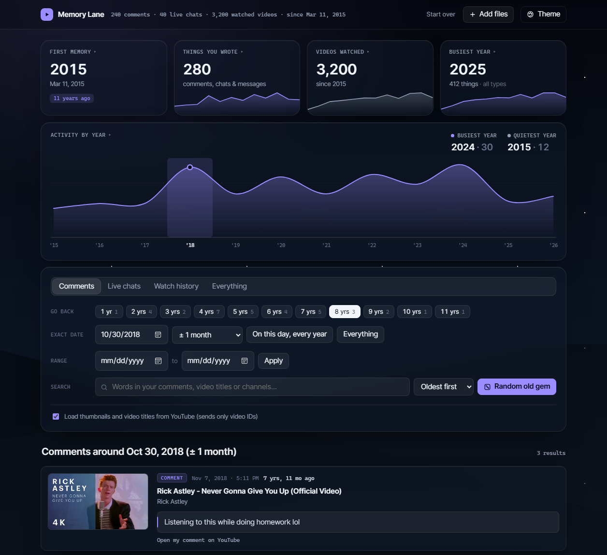

# YouTube Memory Lane

See what you watched and said on YouTube, years ago. Memory Lane turns the data export Google gives you into a timeline of your old comments, live chats, messages, uploads and watch history, with views like "8 years ago", "on this day, every year" and a random old gem.

**Private by design:** it runs entirely in your browser. Your files are never uploaded anywhere.

## How to use it

### 1. Get your data from Google

1. Go to [Google Takeout](https://takeout.google.com) and sign in.
2. Click **Deselect all**, then scroll down and tick **YouTube and YouTube Music**.
3. Click **All YouTube data included** and keep only:
   - **comments**
   - **history**
   - **live chats**
   - **messages**
   - **video metadata** (titles of videos you uploaded)

   Leave **videos** unticked. Uploaded videos can be tens of gigabytes, and Memory Lane doesn't need them.
4. Click **Next step**, keep **Export once** and **.zip**, then click **Create export**.
5. Google emails you when it's ready, usually within an hour. Download every part.

### 2. Open Memory Lane

1. Download this project: click the green **Code** button, then **Download ZIP**, and unzip it.
2. Double-click `index.html`. It opens in your browser.
3. Click **Import your YouTube data** and select every Takeout `.zip` at once. No need to unzip them.

Your data is saved in your browser, so it's there next time. Use **Add files** to add more later, or **Start over** to erase it.

## Features

- **Everything in one timeline:** comments and replies, live chats, messages, your uploads, and watch history.
- **Go back in time:** jump to exactly 1, 5 or 10 years ago (as far back as your data goes), pick any date, see "on this day" across every year, or search everything you've written.
- **Activity chart:** see your busiest and quietest YouTube years at a glance, and click a year to jump to it.
- **Random old gem:** surfaces a forgotten comment or video from years back.
- **Three looks:** Midnight, Glass and Daylight, each with six accent colors.
- **Handles huge exports:** multi-gigabyte, multi-part Takeout zips import in seconds, because uploaded videos are skipped without being loaded.

## Privacy

- Your Takeout files are read by your own browser and never leave your computer. There is no server, account or tracking.
- To show thumbnails and the titles of videos your export doesn't name, the app asks YouTube for them using only the video ID, the same way any web page shows a YouTube thumbnail. Turn this off with the **Load thumbnails and video titles** switch.
- Imported data is kept in your browser's local storage until you click **Start over**.

## What it reads

| Takeout file | Shows up as |
| --- | --- |
| `comments/*.csv` (or older `my-comments.html`) | Comments and replies |
| `live chats/*.csv` | Live chats |
| `messages/conversation_*.csv` | Messages and shared videos |
| `video metadata/video texts.csv` | Your uploads |
| `history/watch-history.html` or `.json` | Watch history |

## Optional: auto-load from a folder

If you have [Node.js](https://nodejs.org), put your unzipped Takeout files in the `my-data` folder and run `start.bat` (Windows) or `node server.js`. The app opens and loads everything in that folder each time. The helper stops on its own shortly after you close the page. Everything in `my-data` is excluded from git.

## License

[MIT](LICENSE)
